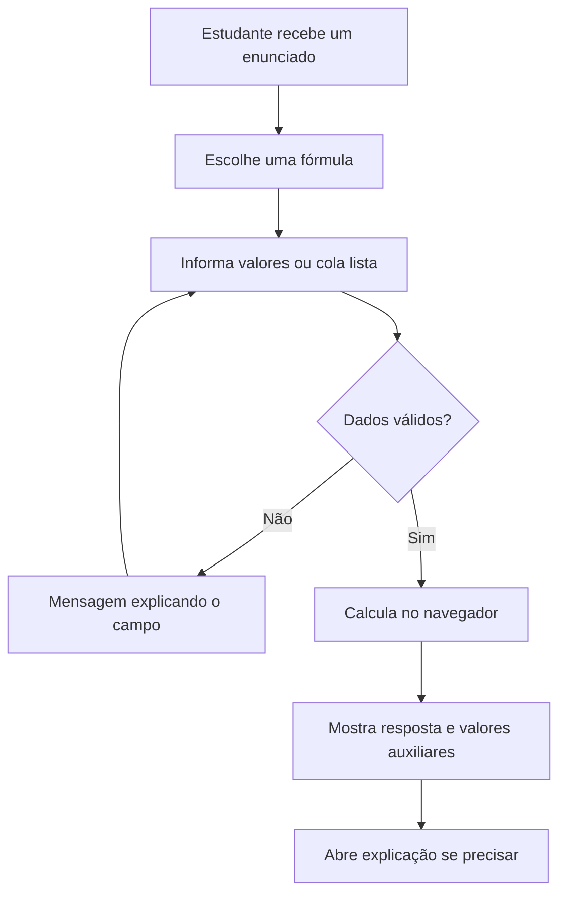
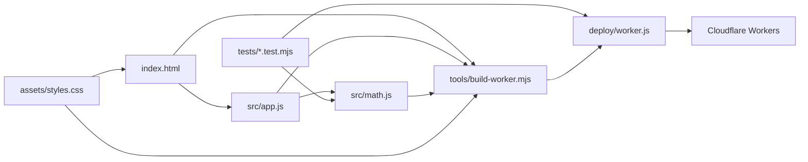
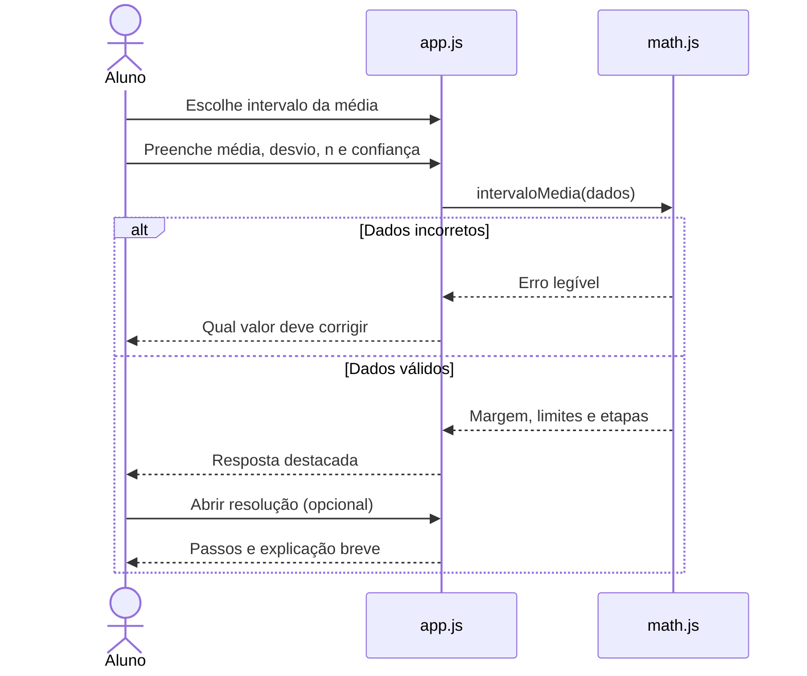

# Diagramas do projeto — Starter Pack

## Caso de uso

## Componentes

## Sequência de uma conta

## Dados e segurança

Não há modelo de banco de dados, entidades persistidas, login ou credenciais. Todos os valores permanecem na memória da página e desaparecem ao fechá-la/recarregá-la. O navegador executa as contas; o Worker apenas entrega os arquivos e um endpoint de saúde.
